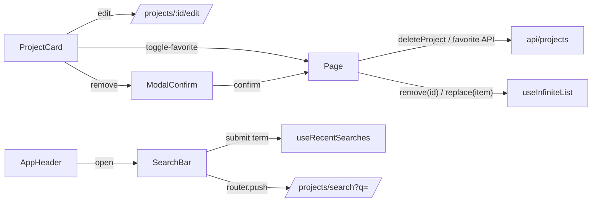

# Projects Design

**Spec**: `.specs/features/projects/spec.md`
**Status**: Approved - approach confirmed by the user ("Composable genérico (Recommended)"), 2026-11-05

---

## Architecture Overview

Feature flow follows AGENTS.md: `types/ → transformers/ → api/ → composables/ + components/ → pages/ → router/ (+ locales/)`.
No new store: each page owns its list through a generic `useInfiniteList` composable. Sorting,
searching, counting and filtering run in the API; every rule the browser still owns (pagination
merge, validation, highlight, recent searches, date formatting) lives in `utils/` or `composables/`,
where Vitest reaches it.

```mermaid
sequenceDiagram
    actor U as User
    participant P as pages/project/Index.vue
    participant L as useInfiniteList
    participant S as InfiniteScrollSentinel
    participant A as api/projects
    participant C as apiRequest
    U->>P: open /projects?sort=name
    P->>L: reset(); loadMore()
    L->>A: listProjects({ sort, page: 1 })
    A->>C: GET /api/v1/projects?sort=name&page=1
    C-->>A: { data: { projects, pagination } }
    A-->>L: { items: Project[], pagination }
    L-->>P: items, count, hasMore
    S-->>P: visible (end of grid)
    P->>L: loadMore()
    L->>A: listProjects({ sort, page: nextPage })
```



---

## Code Reuse Analysis

### Existing Components to Leverage

| Component                                                               | Location                                                            | How to Use                                                                            |
| ----------------------------------------------------------------------- | ------------------------------------------------------------------- | ------------------------------------------------------------------------------------- |
| `apiRequest`, `ApiError`                                                | `src/api/client.ts`                                                 | All requests; extended to send `FormData`                                             |
| `useFormErrors` + `ErrorsHandler`                                       | `src/composables/useFormErrors.ts`, `src/utils/errorsHandler.ts`    | Form errors and 422 `details` → fields (`client_name` → `clientName` already handled) |
| `Validator` / `ValidationResult`                                        | `src/utils/validators/types.ts`                                     | Shape of the new word, date and file validators                                       |
| `keysToCamelCase` / `keysToSnakeCase`                                   | `src/utils/case.ts`                                                 | API ↔ domain mapping                                                                  |
| `JsonApiResource`, `JsonApiObjectResponse`, `MessageSuccessResponseApi` | `src/types/api/`                                                    | Typed API envelopes                                                                   |
| `InputText`                                                             | `src/components/inputs/InputText.vue`                               | Name and client fields (add `(Obrigatório)` label variant)                            |
| `Loading`                                                               | `src/components/Loading.vue`                                        | First load and next-page indicator                                                    |
| `NotificationMessage` + notification store                              | `src/components/NotificationMessage.vue`, `src/stores/notification` | Success / error messages after save, delete, favorite                                 |
| `useUserStore`                                                          | `src/stores/user`                                                   | User id for the recent-search key                                                     |
| `NotFound` page                                                         | `src/pages/NotFound.vue`                                            | Edit of a missing project                                                             |
| e2e `ApiMock`, `test`, `fieldError`                                     | `e2e/support/fixtures.ts`                                           | Mocked e2e for every page                                                             |

### Integration Points

| System                                                | Integration Method                                                |
| ----------------------------------------------------- | ----------------------------------------------------------------- |
| `GET /api/v1/projects?search&sort&page`               | `listProjects` → `{ items, pagination }`                          |
| `GET /api/v1/projects/:id`                            | `getProject` (edit form)                                          |
| `POST /api/v1/projects`, `PATCH /api/v1/projects/:id` | `createProject` / `updateProject`, multipart `FormData`           |
| `DELETE /api/v1/projects/:id`                         | `deleteProject` → `MessageSuccessResponseApi`                     |
| `POST`/`DELETE /api/v1/projects/:id/favorite`         | `createFavorite` / `deleteFavorite` → updated `Project`           |
| Router guard                                          | New routes carry `meta.requiresAuth`; `/` redirects to `projects` |
| `localStorage`                                        | `utils/recentSearches.ts`, key `projects.recentSearches.<userId>` |

---

## Components

### API client - FormData support

- **Purpose**: Let `apiRequest` send multipart bodies.
- **Location**: `src/api/client.ts` (modify)
- **Interfaces**: unchanged signature; when `body instanceof FormData`, omit `Content-Type` so the browser sets the boundary.
- **Reuses**: existing retry/refresh flow.

### Project types

- **Location**: `src/types/project/{project,list,form}.ts` + `index.ts`; `src/types/api/pagination.ts`
- **Interfaces**: see Data Models.

### Project transformers

- **Location**: `src/transformers/project/{project,projectList,projectForm}.ts` + `index.ts`
- **Interfaces**:
  - `projectFromResource(resource: ProjectResourceApi): Project`
  - `projectListFromApi(data: ProjectListDataApi): Page<Project>`
  - `projectFormTransformer.toFormData(payload: ProjectPayload): FormData` - snake_case keys; `cover_image` only when a `File` is present
  - `projectFormTransformer.fromProject(project: Project): ProjectForm`

### Projects API

- **Location**: `src/api/projects/{projects,favorites}.ts` + `index.ts`
- **Interfaces**:
  - `listProjects(query: ProjectListQuery): Promise<Page<Project>>`
  - `getProject(id: string): Promise<Project>`
  - `createProject(payload: ProjectPayload): Promise<ProjectSaveResult>` (`{ project, message }`)
  - `updateProject(id: string, payload: ProjectPayload): Promise<ProjectSaveResult>`
  - `deleteProject(id: string): Promise<MessageSuccessResponseApi>`
  - `createFavorite(id: string): Promise<Project>` / `deleteFavorite(id: string): Promise<Project>`

### Date utils

- **Location**: `src/utils/date.ts`
- **Interfaces**:
  - `parseIsoDate(value: string): Date | null` - `YYYY-MM-DD` as a local calendar date; `null` when malformed or impossible (e.g. `2025-02-30`)
  - `todayIso(now?: Date): string`
  - `formatLongDate(value: string, locale: AppLocale): string` - `01 de setembro de 2024` / `September 01, 2024`

### Validators

- **Location**: `src/utils/validators/{words,date,file}.ts` (exported from `index.ts`)
- **Interfaces**:
  - `minWordsValidator(minimum: number, message: string): Validator` - trims Unicode whitespace (matches `Project::Text`)
  - `dateValidator({ notBefore?: string, check: boolean }, message): Validator` - empty/malformed fails; `notBefore` checked only when `check`
  - `coverFileValidator(file: File | null): ValidationResult` - JPEG/PNG by MIME, ≤ 5 MB

### Highlight util

- **Location**: `src/utils/highlight.ts`
- **Interfaces**: `highlightSegments(text: string, term: string): { text: string; match: boolean }[]` - case- and accent-insensitive (NFD, strip combining marks), returns original characters.

### Recent searches util + composable

- **Location**: `src/utils/recentSearches.ts`, `src/composables/useRecentSearches.ts`
- **Interfaces**:
  - `readRecentSearches(storage, key): string[]` - invalid JSON or non-string items → `[]`
  - `addRecentSearch(list, term, max = 5): string[]` - newest first, case-insensitive dedupe
  - `removeRecentSearch(list, term): string[]`
  - `useRecentSearches()` → `{ searches, add(term), remove(term) }`, key `projects.recentSearches.<userId>`

### useInfiniteList

- **Location**: `src/composables/useInfiniteList.ts`
- **Interfaces**: `useInfiniteList<T extends { id: string }>(fetchPage: (page: number) => Promise<Page<T>>)` → `{ items, count, loading, hasMore, error, loadMore(), reset(), remove(id), replace(item) }`
  - next page = `floor(items.length / limit) + 1`; appended items deduped by id - a removal never skips a project (Edge Cases)
  - `loadMore` is a no-op while `loading` or when `!hasMore`; `hasMore = items.length < count`
  - `remove(id)` drops the item and decrements `count`
- **Reuses**: generic for future CRUDs (AD-003).

### useClickOutside

- **Location**: `src/composables/useClickOutside.ts`
- **Interfaces**: `useClickOutside(target: Ref<HTMLElement | null>, handler: () => void, enabled: Ref<boolean>)` - also calls `handler` on Escape.
- **Used by**: `SelectInput`, `ProjectCard` menu, `SearchBar`.

### Shared components

| Component                | Location                                    | Purpose                                                                                                                              |
| ------------------------ | ------------------------------------------- | ------------------------------------------------------------------------------------------------------------------------------------ |
| `AppHeader`              | `src/components/AppHeader.vue`              | Dark bar, centered logo linking to `projects`; `searchable` prop shows the search icon, which opens `SearchBar`                      |
| `SearchBar`              | `src/components/project/SearchBar.vue`      | Input with icon, recent list (history icon, X), Enter submits, `initialTerm` prop for the result page                                |
| `SelectInput`            | `src/components/inputs/SelectInput.vue`     | Custom dropdown drawn in `projects-select-order.png`; `v-model`, `options`                                                           |
| `ToggleSwitch`           | `src/components/inputs/ToggleSwitch.vue`    | Switch + label; `disabled`-free, emits nothing when `inert` (AD-001)                                                                 |
| `InputDate`              | `src/components/inputs/InputDate.vue`       | `type="date"` with the calendar icon and `(Obrigatório)` label                                                                       |
| `CoverUpload`            | `src/components/inputs/CoverUpload.vue`     | Drop zone + "Selecionar" / preview + trash; emits `select(file)` and `clear`; trash on a saved cover removes it on save                 |
| `ModalConfirm`           | `src/components/ModalConfirm.vue`           | Generic confirm modal (icon, title, message, highlighted name, Cancelar/Confirmar, `loading`) - the `ModalDelete` AGENTS.md asks for |
| `InfiniteScrollSentinel` | `src/components/InfiniteScrollSentinel.vue` | `IntersectionObserver` on an empty div; emits `visible`                                                                              |
| `ProjectCard`            | `src/components/project/ProjectCard.vue`    | Cover/placeholder, star, "..." menu (Editar/Remover), name (with highlight term), client, dates                                      |
| `ProjectGrid`            | `src/components/project/ProjectGrid.vue`    | Grid of `ProjectCard` + sentinel + next-page `Loading`; shared by list and search                                                    |
| `ProjectForm`            | `src/components/project/ProjectForm.vue`    | Fields, blur-time validation, disabled submit, cover; emits `submit(payload)`; `original` prop for edit date rule                    |

### Pages and routes

| Page                           | Route (name)                            | Captures                                                               |
| ------------------------------ | --------------------------------------- | ---------------------------------------------------------------------- |
| `src/pages/project/Index.vue`  | `/projects` (`projects`)                | empty-list, list, select-order, item-options, modal-remove, search-bar |
| `src/pages/project/Search.vue` | `/projects/search?q=` (`projectSearch`) | search-result                                                          |
| `src/pages/project/New.vue`    | `/projects/new` (`newProject`)          | new-project, new-project-validations                                   |
| `src/pages/project/Edit.vue`   | `/projects/:id/edit` (`editProject`)    | edit-project                                                           |

`src/router/projects.ts` is spread into `router/index.ts`; `home` (`/`) becomes `redirect: { name: 'projects' }` so the guards' `{ name: 'home' }` keeps working. `Home.vue` is deleted.

Favorite and remove handlers live in a small composable `src/composables/useProjectActions.ts`
(`toggleFavorite(project)`, `removeProject(project)`), shared by Index and Search, calling the API,
updating `useInfiniteList` and the notification store. In-flight favorite ids are tracked there (P1 Favorite, AC 4).

---

## Data Models

```typescript
// types/api/pagination.ts
type PaginationApi = { page: number; pages: number; count: number; limit: number }
type Page<T> = { items: T[]; pagination: PaginationApi }

// types/project/project.ts
type Project = {
  id: string
  name: string
  clientName: string
  startDate: string // YYYY-MM-DD
  endDate: string
  favorite: boolean
  coverImageUrl: string | null
}
type ProjectAttributesApi = {
  id: string
  name: string
  client_name: string
  start_date: string
  end_date: string
  favorite: boolean
  cover_image_url: string | null
}
type ProjectResourceApi = JsonApiResource<'project', ProjectAttributesApi>

// types/project/list.ts
type ProjectSort = 'name' | 'recent_start' | 'nearest_deadline'
type ProjectListQuery = { page: number; sort?: ProjectSort; search?: string }
type ProjectListDataApi = { projects: { data: ProjectResourceApi[] }; pagination: PaginationApi }

// types/project/form.ts
type ProjectForm = {
  name: string
  clientName: string
  startDate: string
  endDate: string
  coverImage: File | null
}
type ProjectPayload = ProjectForm
type ProjectSaveResult = { project: Project; message: string }
```

---

## Error Handling Strategy

| Error Scenario                 | Handling                                                     | User Impact                        |
| ------------------------------ | ------------------------------------------------------------ | ---------------------------------- |
| List request fails             | `useInfiniteList.error`; page sets the notification (danger) | Error message; existing cards stay |
| 401 during any request         | Existing `apiRequest` refresh → sign-in                      | Redirect to sign-in                |
| 404 on edit load               | Edit page renders `NotFound`                                 | "Página não encontrada"            |
| 422 on create/update           | `useFormErrors.applyCatch` → field errors / base             | Messages under fields, input kept  |
| Favorite fails                 | Card unchanged, notification danger                          | Star as before + message           |
| Delete fails                   | Modal closes, card kept, notification danger                 | Message                            |
| Network / non-JSON error       | `ApiError` with fallback message                             | "Algo deu errado..."               |
| Invalid `localStorage` content | `readRecentSearches` returns `[]`                            | No recent list, no crash           |

---

## Risks & Concerns

| Concern                                                        | Location (file:line)                     | Impact                                                                          | Mitigation                                                                       |
| -------------------------------------------------------------- | ---------------------------------------- | ------------------------------------------------------------------------------- | -------------------------------------------------------------------------------- |
| `apiRequest` always sets `Content-Type: application/json`      | `src/api/client.ts:82`                   | Multipart upload sent with the wrong header; Rails can't parse the file         | T2 skips the header for `FormData`, with a unit test                             |
| e2e mock records only `pathname` and parses bodies as JSON     | `e2e/support/fixtures.ts:144`            | Can't assert `?sort=`/`?search=`/`?page=`; `postDataJSON()` throws on multipart | T5 records `query` and the raw body for non-JSON requests                        |
| Offset pagination + deletion shifts pages                      | API `pagy(:offset)`                      | Next page would skip one project after a removal                                | `useInfiniteList` computes the next page from the loaded count and dedupes by id |
| Router guard clears the notification on every navigation       | `src/router/index.ts:51`                 | A message set before `router.push` disappears                                   | Set the message after `await router.push(...)` (same as `Registration.vue`)      |
| `<input type="date">` value is empty for partially typed dates | browser behaviour                        | "Malformed" can't be told from "empty"                                          | Both show "Selecione uma data válida" (spec assumption)                          |
| Font from Google Fonts                                         | `index.html`                             | Offline runs fall back to system font; pictures differ                          | Pictures are taken online; fallback stack keeps layout usable                    |
| `InputText` default `maxlength` 250                            | `src/components/inputs/InputText.vue:20` | Spec says 255                                                                   | Project fields pass `:maxlength="255"`                                           |

---

## Tech Decisions (only non-obvious ones)

| Decision                            | Choice                                                                                 | Rationale                                                                              |
| ----------------------------------- | -------------------------------------------------------------------------------------- | -------------------------------------------------------------------------------------- |
| List state                          | `useInfiniteList` composable per page, no store                                        | User choice; list and search share no data                                             |
| Next page number                    | `floor(loaded / limit) + 1` + dedupe                                                   | Survives deletions with offset pagination                                              |
| Validation timing                   | Validate the whole form on every change; show a field's error only once it was blurred | Disabled submit needs full validity; capture shows errors only on touched fields       |
| Highlight                           | Pure util returning segments, rendered with `<mark>`                                   | No `v-html`; testable                                                                  |
| Header placement                    | `AppHeader` rendered by each project page                                              | Variant differs per page (search icon only on the list, search bar on the result page) |
| Custom select instead of `<select>` | `SelectInput` component                                                                | The open state in `projects-select-order.png` can't be styled with a native select     |
| Font                                | Google Fonts `<link>` for "Encode Sans Semi Expanded"                                  | No dependency added                                                                    |
