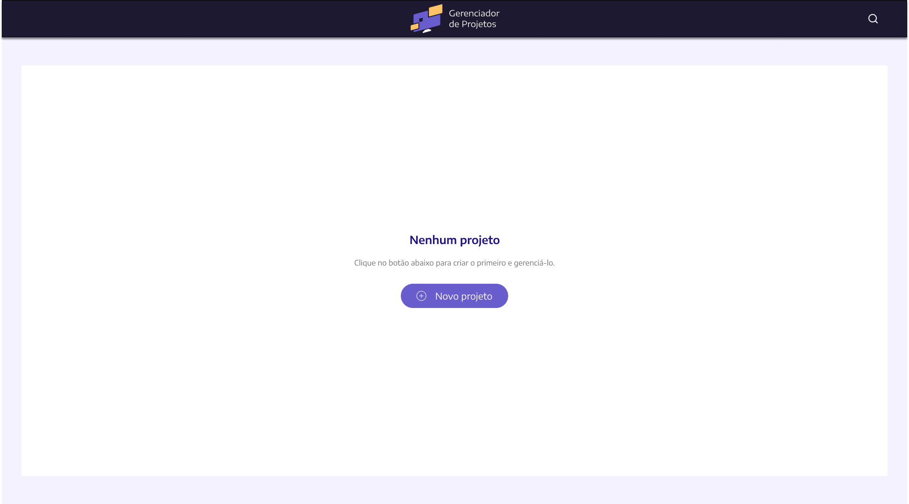
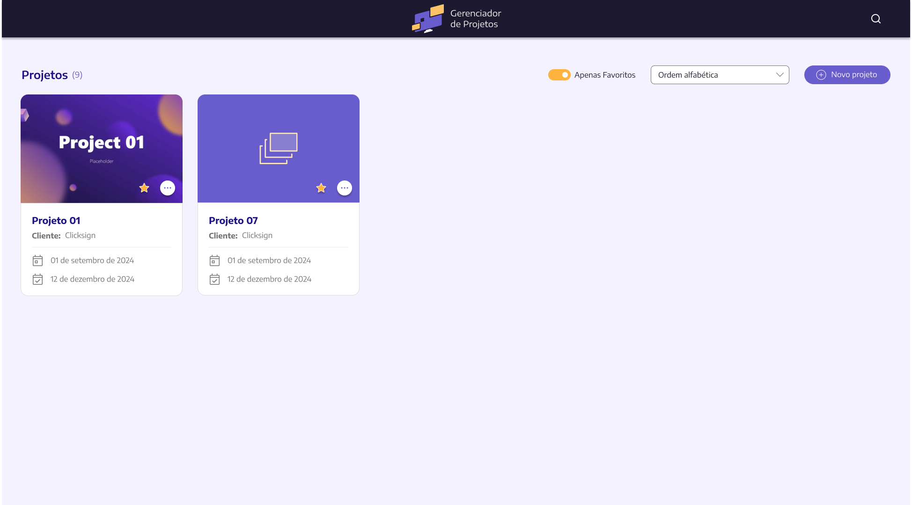
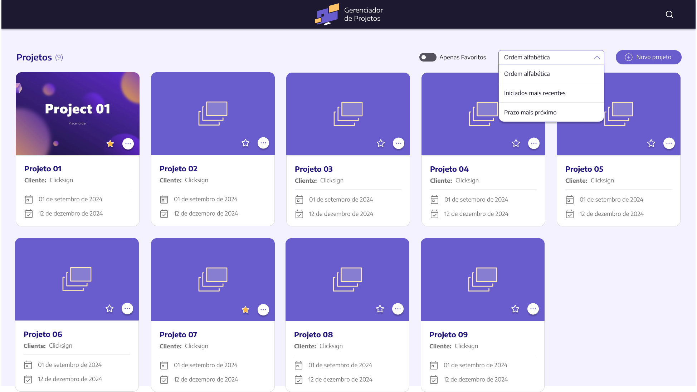
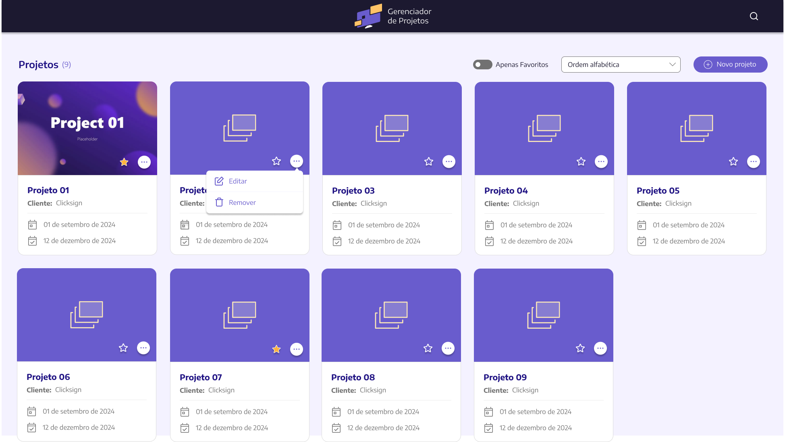
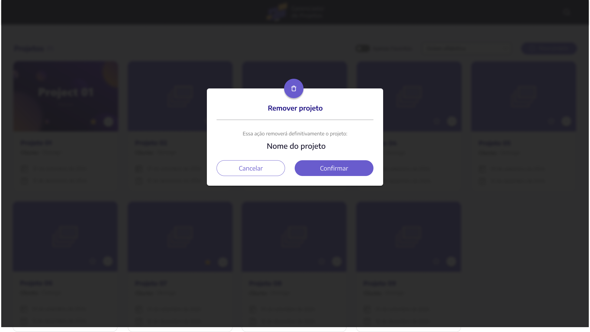
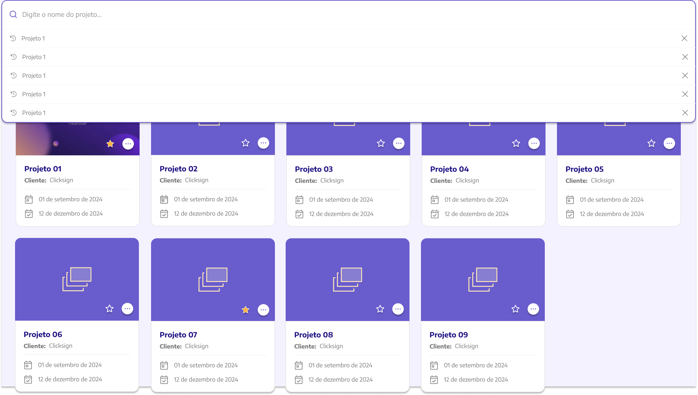
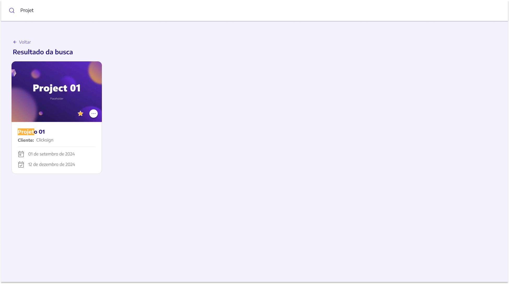
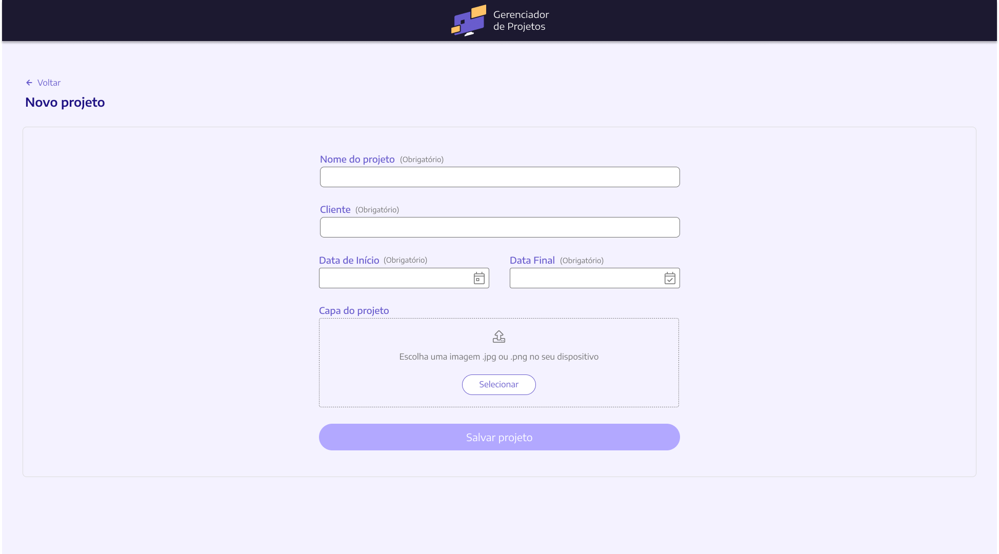
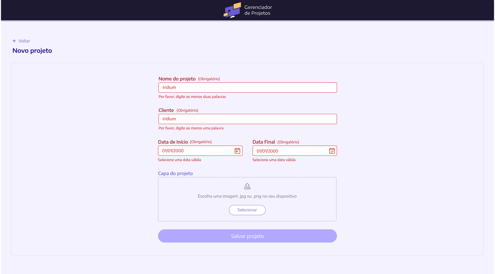
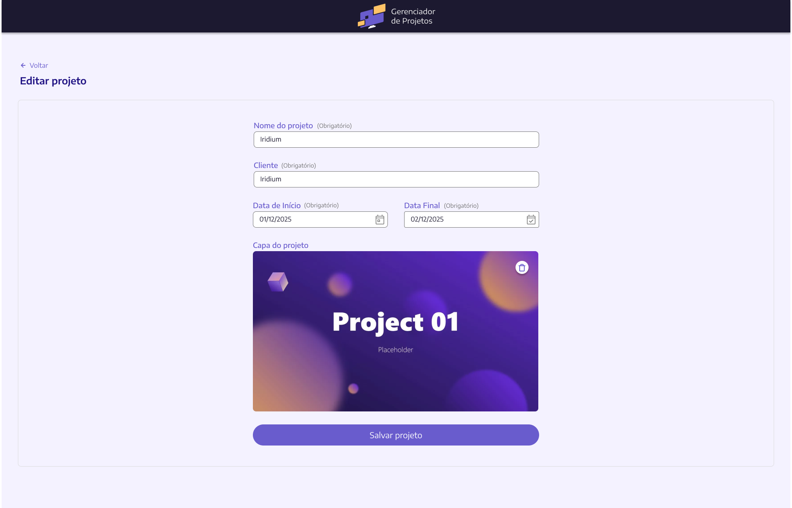

# Projects Specification

**Approved**: 2026-11-05 - user: "aprovado"

## Problem Statement

A signed-in user has no way to see or manage projects: after login the app shows an empty `Home`. The
Rails API already exposes projects (`/api/v1/projects` index/show/create/update/destroy and
`/api/v1/projects/:id/favorite` create/destroy). This feature delivers the screens the design draws:
list, sort, favorite, search with recent searches, create, edit and remove.

## Goals

- [ ] A signed-in user lists, creates, edits, favorites and removes their projects from the screens in `captures/`.
- [ ] A user finds a project by name or client from the header search and re-runs any of their last 5 searches in one click.

## Out of Scope

| Feature                              | Reason                                                                   |
| ------------------------------------ | ------------------------------------------------------------------------ |
| Filtering the list by favorites      | API has no favorite filter; the toggle stays without action (AD-001)     |
| Profile / logout links in the header | User chose to follow the capture: header holds only logo and search      |
| Project detail page                  | No capture; the API `show` is used only to fill the edit form            |
| Changes to the Rails API             | Both missing capabilities will be added to the API later by the user     |
| Layout below 768 px                  | Captures are desktop only (1940 px); see Assumptions for narrower widths |

---

## Assumptions & Open Questions

| Assumption / decision                                       | Chosen default                                                                                                                                                                            | Rationale                                                                                                              | Confirmed? |
| ----------------------------------------------------------- | ----------------------------------------------------------------------------------------------------------------------------------------------------------------------------------------- | ---------------------------------------------------------------------------------------------------------------------- | ---------- |
| Favorites toggle                                            | Rendered as in `projects-list.png`, off, and clicking it changes nothing                                                                                                                  | user: "deixe sem ação, eu vou implementar na api depois" (AD-001)                                                      | y          |
| Cover trash icon (edit, saved cover)                        | Hides the saved cover and shows the drop zone; the next save sends `remove_cover_image=true`                                                                                              | API now removes a cover (AD-002 superseded)                                                                            | n          |
| More than 20 projects                                       | Infinite scroll: next page loads when the end of the grid comes into view                                                                                                                 | user: "Scroll infinito" (AD-003)                                                                                       | y          |
| Header content                                              | Logo + search icon only, as captured                                                                                                                                                      | user: "Seguir a tela (Recommended)"                                                                                    | y          |
| Trash icon on a cover picked in this form but not saved yet | Clears the picked file and shows the "Selecionar" drop zone again                                                                                                                         | Without it a wrong pick can't be undone; no API involved, so AD-002 does not apply                                     | n          |
| Routes                                                      | `/projects` (`projects`), `/projects/new` (`newProject`), `/projects/:id/edit` (`editProject`), `/projects/search?q=` (`projectSearch`); `/` redirects to `/projects`; all `requiresAuth` | Follows `router/users.ts` naming; `home` keeps working for the guards                                                  | n          |
| Sort persistence                                            | Selected sort lives in the URL query `?sort=`; default `name`                                                                                                                             | Survives reload and back navigation without a store                                                                    | n          |
| Search trigger                                              | Enter submits; a term with fewer than 3 characters after trimming sends nothing                                                                                                           | API rejects searches shorter than 3 characters (`Project::Search`)                                                     | n          |
| Recent searches storage                                     | `localStorage`, key scoped by user id, newest first, max 5, duplicates (case-insensitive) moved to the top                                                                                | Request says "umas 5 pesquisas recentes usando localStorage"; scoping avoids leaking between users on a shared browser | n          |
| Search highlight                                            | Case- and accent-insensitive match of the term highlighted in the project name and the client name, as in `projects-search-result.png`                                                                        | API matches with `unaccent ILIKE`; highlighting must agree with what matched                                           | n          |
| Empty search result                                         | Text "Nenhum projeto encontrado" under "Resultado da busca"                                                                                                                               | Not captured; a blank page reads as broken                                                                             | n          |
| Validation timing                                           | A field shows its error after it loses focus; "Salvar projeto" is disabled while any field is invalid                                                                                     | `new-project.png` shows the button disabled on an empty form; `edit-project.png` shows it enabled when valid           | n          |
| Date rules in edit                                          | "Not before today" applies only to a date changed from the loaded value                                                                                                                   | Mirrors `Project::Update#date_checked?` so a running project stays editable                                            | n          |
| Empty or malformed date                                     | Shows "Selecione uma data válida"                                                                                                                                                         | Same message the capture uses for invalid dates                                                                        | n          |
| Cover file check                                            | Client rejects files not JPEG/PNG or over 5 MB with "Selecione uma imagem .jpg ou .png de até 5 MB"                                                                                       | API limits (`Project::CoverImage`); message not captured                                                               | n          |
| Date display on cards                                       | `pt-BR`: "01 de setembro de 2024"; `en`: "September 01, 2024"; API dates parsed as local calendar dates                                                                                   | Capture format; avoids a one-day shift from UTC parsing                                                                | n          |
| Count "(N)" next to "Projetos"                              | `pagination.count` from the API                                                                                                                                                           | The total the API reports, not the cards loaded so far                                                                 | n          |
| Remove failure                                              | Modal closes and the API error shows in the notification; the card stays                                                                                                                  | Same notification pattern as the user pages                                                                            | n          |
| Favorite star                                               | Star changes after the API responds; on failure it stays as it was and the error shows in the notification                                                                                | No optimistic state to roll back                                                                                       | n          |
| Narrower windows                                            | Grid fills as many 346 px cards per row as fit; captures are judged at 1940 px                                                                                                            | Captures draw only desktop                                                                                             | n          |
| Font                                                        | "Encode Sans Semi Expanded" from `design/files/style.css`, loaded in `index.html`                                                                                                         | The captures use it throughout                                                                                         | n          |

**Open questions:** none - all resolved or logged above (required before the spec is confirmed).

---

## User Stories

### P1: Browse projects ⭐ MVP

**User Story**: As a signed-in user, I want to see my projects as cards so that I know what I'm working on.

**Why P1**: Every other story starts from this page.

**Acceptance Criteria**:

1. WHEN a signed-in user opens `/projects` and has no projects THEN the system SHALL show the page in `.specs/features/projects/captures/projects-empty-list.png`.
2. WHEN a signed-in user opens `/projects` and has projects THEN the system SHALL show the page in `.specs/features/projects/captures/projects-list.png`, one card per project with cover (or the placeholder icon), name, "Cliente:" and client name, start date and end date.
3. The system SHALL show next to "Projetos" the total count of the user's projects as reported by the API, in parentheses.
4. WHEN a project has no cover image THEN the system SHALL show the placeholder icon on the purple background drawn in `projects-list.png`.
5. WHEN the user clicks "Novo projeto" (empty state or list header) THEN the system SHALL navigate to `/projects/new`.
6. WHEN the end of the grid comes into view and more pages exist THEN the system SHALL load the next page and append its cards after the current ones.
7. WHILE the next page is loading the system SHALL show the existing `Loading` indicator below the grid and SHALL NOT request the same page twice.
8. WHEN the last page has loaded THEN the system SHALL make no further list requests on scroll.
9. IF the list request fails THEN the system SHALL show the API error message in the notification.
10. WHEN a signed-out user opens any `/projects` route THEN the system SHALL redirect to sign-in with the route as `redirect`.
11. WHEN a signed-in user opens `/` THEN the system SHALL redirect to `/projects`.
12. WHILE a project page is shown the system SHALL show the header drawn in the captures: logo centered, search icon on the left on the list page, and no other controls.
13. WHEN the user clicks the header logo THEN the system SHALL navigate to `/projects`.

**Independent Test**: Sign in with 0 projects → empty state; seed 25 projects → 20 cards, count "(25)", scroll to bottom → 25 cards and no further request.

---

### P1: Sort projects ⭐ MVP

**User Story**: As a user, I want to order my projects so that the one I need is near the top.

**Why P1**: Drawn on every list capture.

**Acceptance Criteria**:

1. WHEN the user opens the sort select THEN the system SHALL show the options in `.specs/features/projects/captures/projects-select-order.png`: "Ordem alfabética", "Iniciados mais recentes", "Prazo mais próximo".
2. WHEN the user picks an option THEN the system SHALL reload the list from page 1 with `sort` = `name`, `recent_start` or `nearest_deadline` respectively, and close the select.
3. The system SHALL use `name` ("Ordem alfabética") when the URL has no valid `sort`.
4. WHEN the page is reloaded with `?sort=<value>` THEN the system SHALL show that option selected and the list in that order.
5. WHEN the user clicks outside the open select or presses Escape THEN the system SHALL close it without changing the order.

**Independent Test**: Pick "Prazo mais próximo" → request has `sort=nearest_deadline`, URL has `?sort=nearest_deadline`, reload keeps it.

---

### P1: Favorite a project ⭐ MVP

**User Story**: As a user, I want to star projects so that the important ones stand out.

**Why P1**: The star is on every card in every list capture.

**Acceptance Criteria**:

1. WHEN the user clicks the empty star on a card THEN the system SHALL call `POST /api/v1/projects/:id/favorite` and, on success, show the filled orange star.
2. WHEN the user clicks the filled star on a card THEN the system SHALL call `DELETE /api/v1/projects/:id/favorite` and, on success, show the empty star.
3. IF the favorite request fails THEN the system SHALL keep the star as it was and show the API error message in the notification.
4. WHILE a favorite request for a card is in flight the system SHALL ignore further clicks on that card's star.
5. The system SHALL show the "Apenas Favoritos" toggle off, as in `projects-list.png`, and clicking it SHALL change neither the toggle nor the list (AD-001; `projects-list-favorites.png` is deferred).

**Independent Test**: Click a star → filled after `POST` 200; click again → empty after `DELETE` 200; force 500 → star unchanged plus error.

---

### P1: Create a project ⭐ MVP

**User Story**: As a user, I want to create a project with name, client, dates and an optional cover.

**Why P1**: Without it the list stays empty.

**Acceptance Criteria**:

1. WHEN the user opens `/projects/new` THEN the system SHALL show the form in `.specs/features/projects/captures/new-project.png` with "Salvar projeto" disabled.
2. IF the project name, after trimming, has fewer than two words THEN the system SHALL mark the field red and show "Por favor, digite ao menos duas palavras", as in `.specs/features/projects/captures/new-project-validations.png`.
3. IF the client, after trimming, is empty THEN the system SHALL mark the field red and show "Por favor, digite ao menos uma palavra" (AD-004).
4. IF the start date is empty, malformed or before today THEN the system SHALL mark the field red and show "Selecione uma data válida".
5. IF the end date is empty, malformed, before today or before the start date THEN the system SHALL mark the field red and show "Selecione uma data válida".
6. The system SHALL limit project name and client to 255 characters.
7. WHILE any field is invalid the system SHALL keep "Salvar projeto" disabled.
8. WHEN the user clicks "Selecionar" THEN the system SHALL open a file picker limited to `.jpg`, `.jpeg` and `.png`.
9. WHEN the user picks a JPEG or PNG up to 5 MB THEN the system SHALL show it as the cover preview drawn in `edit-project.png` in place of the drop zone.
10. IF the picked file is not JPEG/PNG or is larger than 5 MB THEN the system SHALL keep the drop zone and show "Selecione uma imagem .jpg ou .png de até 5 MB".
11. WHEN the user clicks the trash icon on a cover picked in this form THEN the system SHALL discard the pick and show the drop zone again.
12. WHEN the user submits a valid form THEN the system SHALL send `POST /api/v1/projects` as multipart with `name`, `client_name`, `start_date`, `end_date` and, if picked, `cover_image`, then navigate to `/projects` and show the API success message.
13. WHILE the save request is in flight the system SHALL disable "Salvar projeto" and show its loading state.
14. IF the API answers 422 THEN the system SHALL show each message from `details` under its field and keep the user's input.
15. WHEN the user clicks "Voltar" THEN the system SHALL navigate to `/projects` without saving.

**Independent Test**: Type "Iridium" as name, blur → two-words error; fill valid data with a PNG → `POST` multipart, redirect to the list with the new card and success notification.

---

### P1: Edit a project ⭐ MVP

**User Story**: As a user, I want to change a project's data and cover.

**Why P1**: Drawn in `edit-project.png` and reachable from every card.

**Acceptance Criteria**:

1. WHEN the user clicks the "..." button on a card THEN the system SHALL open the menu in `.specs/features/projects/captures/projects-item-options.png` with "Editar" and "Remover", closing any other open card menu.
2. WHEN the user clicks outside an open card menu or presses Escape THEN the system SHALL close it.
3. WHEN the user clicks "Editar" THEN the system SHALL navigate to `/projects/:id/edit`.
4. WHEN `/projects/:id/edit` opens THEN the system SHALL load `GET /api/v1/projects/:id` and show the form in `.specs/features/projects/captures/edit-project.png` filled with the project's name, client, dates and cover.
5. IF the project is not found (404) THEN the system SHALL show the existing NotFound page.
6. WHERE the project has a saved cover the system SHALL show it with the trash icon, and clicking the icon SHALL hide it, show the drop zone and, on save without a new file, send `remove_cover_image=true` (AD-002 superseded).
7. The system SHALL apply the create-form rules (P1 Create, criteria 2-11) to the edit form, except that "not before today" applies only to a date changed from its loaded value.
8. WHEN the user submits a valid form THEN the system SHALL send `PATCH /api/v1/projects/:id` as multipart with the fields and, only if a new file was picked, `cover_image`, then navigate to `/projects` and show the API success message.
9. IF the API answers 422 THEN the system SHALL show each message from `details` under its field and keep the user's input.
10. WHEN the user clicks "Voltar" THEN the system SHALL navigate to `/projects` without saving.

**Independent Test**: Open edit of a project starting yesterday, change only the name → saves; change start date to yesterday → "Selecione uma data válida".

---

### P1: Remove a project ⭐ MVP

**User Story**: As a user, I want to delete a project I no longer need, with a confirmation.

**Why P1**: Drawn in `modal-remove-project.png`.

**Acceptance Criteria**:

1. WHEN the user clicks "Remover" in a card menu THEN the system SHALL open the modal in `.specs/features/projects/captures/modal-remove-project.png` showing that project's name.
2. WHEN the user clicks "Cancelar", the backdrop, or presses Escape THEN the system SHALL close the modal and keep the project.
3. WHEN the user clicks "Confirmar" THEN the system SHALL call `DELETE /api/v1/projects/:id`, close the modal, remove the card, decrease the count by 1 and show the API success message.
4. WHILE the delete request is in flight the system SHALL disable "Confirmar" and "Cancelar".
5. IF the delete request fails THEN the system SHALL close the modal, keep the card and show the API error message.
6. WHEN the last project is removed THEN the system SHALL show the empty state in `projects-empty-list.png`.

**Independent Test**: Remove "Projeto 02" → modal names it; Confirmar → `DELETE`, card gone, "(8)".

---

### P2: Search projects

**User Story**: As a user, I want to search my projects by name or client from the header.

**Why P2**: The list is usable without it, but the header icon is drawn on every list capture.

**Acceptance Criteria**:

1. WHEN the user clicks the header search icon THEN the system SHALL replace the header with the search bar in `.specs/features/projects/captures/search-bar.png`, focused, with placeholder "Digite o nome do projeto ou o nome do cliente...".
2. WHEN the user presses Enter with a term of at least 3 characters after trimming THEN the system SHALL navigate to `/projects/search?q=<term>` and save the term as a recent search.
3. IF the user presses Enter with fewer than 3 characters after trimming THEN the system SHALL send no request and stay on the current page.
4. WHEN `/projects/search?q=<term>` opens THEN the system SHALL show the page in `.specs/features/projects/captures/projects-search-result.png`: the term in the top bar, "Voltar", "Resultado da busca" and the cards returned by `GET /api/v1/projects?search=<term>`.
5. The system SHALL highlight in each result's name and client name every case- and accent-insensitive occurrence of the term, as in `projects-search-result.png`.
6. WHEN the search returns no projects THEN the system SHALL show "Nenhum projeto encontrado" under "Resultado da busca".
7. The system SHALL apply infinite scroll, favorite star and card menu (Editar/Remover) on the search result as on the list.
8. WHEN the user clicks "Voltar" on the search result THEN the system SHALL navigate to `/projects`.
9. WHEN the user presses Escape or clicks outside the open search bar THEN the system SHALL close it and show the header again.

**Independent Test**: Search "Projet" → `/projects/search?q=Projet`, cards with "Projet" highlighted; "ab" + Enter → nothing happens.

---

### P2: Recent searches

**User Story**: As a user, I want my last searches listed when I open the search bar so I can repeat one.

**Why P2**: Requested ("deve listar umas 5 pesquisas recentes usando localStorage"); depends on search.

**Acceptance Criteria**:

1. WHEN the search bar opens THEN the system SHALL list up to 5 recent searches, newest first, each with the history icon and an "X", as in `search-bar.png`.
2. WHEN a search is saved and 5 are already stored THEN the system SHALL drop the oldest.
3. WHEN a saved term matches a stored one case-insensitively THEN the system SHALL move it to the top instead of storing a duplicate.
4. WHEN the user clicks a recent search THEN the system SHALL run that search as in P2 Search, criterion 2.
5. WHEN the user clicks the "X" on a recent search THEN the system SHALL remove it from the list and from `localStorage`, keeping the bar open.
6. The system SHALL store recent searches in `localStorage` under a key that includes the signed-in user's id.
7. IF the stored value is missing or not a valid list of strings THEN the system SHALL show no recent searches and SHALL NOT throw.

**Independent Test**: Search 6 distinct terms → bar shows the last 5 newest first; reload → same 5; click "X" on one → 4.

---

## Edge Cases

- IF the user double-clicks "Salvar projeto" THEN the system SHALL send one create/update request.
- IF a project name or client is longer than the card width THEN the system SHALL wrap it onto the next lines without an ellipsis, and every card in the same grid row SHALL grow to the tallest one, keeping the name/client divider aligned (the extra space goes between the client and the divider).
- WHEN a project is removed while further pages remain THEN the system SHALL keep loading the remaining pages without skipping a project.
- IF the session expires during any project request THEN the system SHALL follow the existing refresh-then-sign-in flow of `apiRequest`.
- IF `/projects/search` opens with a `q` shorter than 3 characters after trimming THEN the system SHALL redirect to `/projects` without a search request.

---

## Requirement Traceability

| Requirement ID | Story                                                    | Phase  | Status  |
| -------------- | -------------------------------------------------------- | ------ | ------- |
| PROJ-01        | P1: Browse projects (1-4, 12-13)                         | Tasks  | In Tasks |
| PROJ-02        | P1: Browse projects - infinite scroll (6-8)              | Tasks  | In Tasks |
| PROJ-03        | P1: Browse projects - navigation, auth, errors (5, 9-11) | Tasks  | In Tasks |
| PROJ-04        | P1: Sort projects                                        | Tasks  | In Tasks |
| PROJ-05        | P1: Favorite a project                                   | Tasks  | In Tasks |
| PROJ-06        | P1: Create a project - form and validation (1-11, 15)    | Tasks  | In Tasks |
| PROJ-07        | P1: Create a project - submit (12-14)                    | Tasks  | In Tasks |
| PROJ-08        | P1: Edit a project - card menu (1-3)                     | Tasks  | In Tasks |
| PROJ-09        | P1: Edit a project - load and submit (4-10)              | Tasks  | In Tasks |
| PROJ-10        | P1: Remove a project                                     | Tasks  | In Tasks |
| PROJ-11        | P2: Search projects                                      | Tasks  | In Tasks |
| PROJ-12        | P2: Recent searches                                      | Tasks  | In Tasks |
| PROJ-13        | Edge Cases                                               | Tasks  | In Tasks |
| PROJ-14        | Edge Cases - search route guard (found by the Verifier) | Tasks  | In Tasks |

**Coverage:** 14 total, 14 mapped to tasks (T1-T27 + verification fixes), 0 unmapped

---

## Differences from the source

| Source shows                                                            | Product shows                              | Confirmed  |
| ----------------------------------------------------------------------- | ------------------------------------------ | ---------- |
| `projects-list-favorites.png`: toggle on, only favorite projects listed | Toggle stays off; clicking it does nothing | y - AD-001 |
| `new-project-validations.png`: "Por favor, digite ao menos uma palavra" under client "Iridium" | No error for "Iridium"; the error shows only for a blank client | y - AD-004 |

## Sources

- `/Users/eliezersalvato/projects/tests/project_management_ruby_api/app/controllers/api/v1/projects_controller.rb` and `project/favorites_controller.rb` - endpoints, params (`search`, `sort`), 20 per page, validations and messages
- `design/files/style.css` - colors, font family and sizes of the captures
- `design/files/` (logo) and `design/icons/` - logo and icon assets used by the screens (assets, not screen captures)
-  - binding - list with no projects
-  - binding - list with cards, toggle, sort select, "Novo projeto"
-  - binding - favorites filter on (deferred, AD-001)
-  - binding - sort select open
-  - binding - card menu open
-  - binding - remove confirmation modal
-  - binding - search bar open with recent searches
-  - binding - search result page with highlight
-  - binding - create form, empty
-  - binding - create form with errors
-  - binding - edit form with cover

---

## Success Criteria

- [ ] Every criterion above has a passing unit or e2e test, and each capture's state is retaken at 1940 px and judged against it.
- [ ] `pnpm type-check`, `pnpm lint` and the test suites pass.
